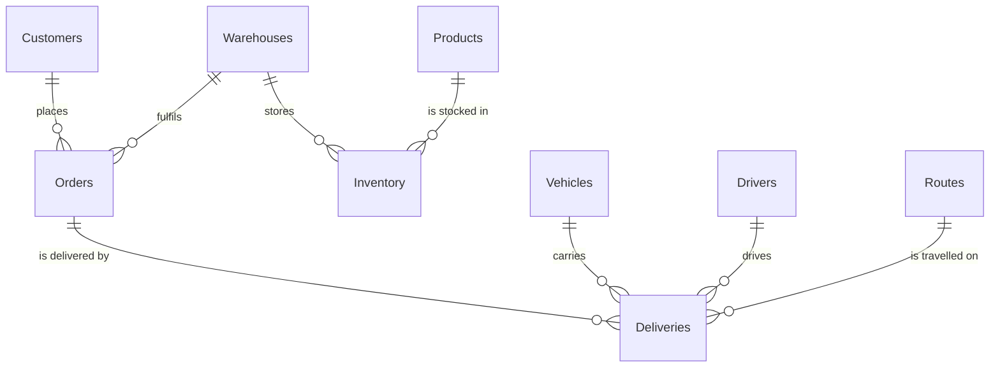

LogiTrack: Supply Chain & Logistics SQL Analysis
A MySQL project that models a logistics company's warehouses, inventory, orders, fleet, drivers, routes and deliveries, and uses SQL to answer six business questions about stock, fuel efficiency, driver performance, delivery status and cost.
  
---
Table of Contents
Business Problem
Project Files
Database Design
How to Run
SQL Concepts Used
Insights and Results
Key Takeaways
Recommendations
Author
---
Business Problem
A logistics company handles products, warehouses, customer orders, vehicles and deliveries every day. It needs to know:
How much stock each warehouse holds, and which products are running low
Which vehicle types are the most fuel efficient
Which drivers perform above average
How many deliveries are on time, delayed or pending, and what each group costs
Which routes have the highest fuel cost
Goal: show how SQL can help improve warehouse operations, fleet use and delivery performance.
---
Project Files
File	Description
`logitrack_.sql`	Creates the `LogiTrack` database, 9 tables, sample data, and the 6 analysis queries
`logitrack__.mwb`	MySQL Workbench model file with the EER diagram
`README.md`	Project documentation
---
Database Design
The database has 9 related tables with 6 sample records each.
Table	Purpose
`Warehouses`	Warehouse name, city, state, capacity and manager
`Products`	Product name, category, unit price and weight
`Inventory`	Stock quantity and reorder level of each product in a warehouse
`Customers`	Customer name, city, state and type (Retail or Business)
`Orders`	Customer orders with date, status and value
`Vehicles`	Vehicle type, capacity, fuel type, fuel efficiency and maintenance status
`Drivers`	Driver experience in years and rating
`Routes`	Source and destination city, distance and estimated time
`Deliveries`	Delivery status, dates, delivery cost and fuel cost
Entity Relationships

---
How to Run
Requirements: MySQL 8.0 or later and MySQL Workbench (or any MySQL client).
Clone the repository
```bash
   git clone https://github.com/<your-username>/<your-repo>.git
   cd <your-repo>
   ```
Open `logitrack_.sql` in MySQL Workbench.
Run the whole script (lightning icon). It drops and recreates the `LogiTrack` database, so do not run it on a database you want to keep.
Run the queries under Insights Analysis one at a time to see the results.
To view the EER diagram, open `logitrack__.mwb` in MySQL Workbench.
---
SQL Concepts Used
Level	Concepts
Basic	`SELECT`, `WHERE`, `ORDER BY`
Intermediate	`GROUP BY`, aggregate functions (`SUM`, `COUNT`, `AVG`, `ROUND`), `INNER JOIN`, calculated columns
Advanced	Subquery, `RANK()` window function
---
Insights and Results
Results below come from running the queries in `logitrack_.sql` on the sample data.
1. Which warehouse holds the most stock?
```sql
SELECT w.warehouse_name, SUM(i.stock_quantity) AS total_stock
FROM Inventory i
INNER JOIN Warehouses w ON i.warehouse_id = w.warehouse_id
GROUP BY w.warehouse_name
ORDER BY total_stock DESC;
```
warehouse_name	total_stock
Pune Distribution Center	1200
Mumbai Central Warehouse	900
Hyderabad Warehouse	750
Bangalore Supply Hub	500
Delhi Logistics Hub	80
Insight: Pune holds the most stock. Delhi holds the least, only 80 units. Chennai has no inventory records, so it does not appear in the result.
2. Which products are furthest below reorder level?
```sql
SELECT p.product_name, i.stock_quantity, i.reorder_level,
       i.reorder_level - i.stock_quantity AS shortfall
FROM Inventory i
INNER JOIN Products p ON i.product_id = p.product_id
WHERE i.stock_quantity < i.reorder_level
ORDER BY shortfall DESC;
```
product_name	stock_quantity	reorder_level	shortfall
Laptop	50	100	50
Office Chair	80	100	20
Insight: Two products need reordering. The Laptop is short by 50 units and the Office Chair by 20 units, so the Laptop should be reordered first.
3. Which vehicle type uses fuel best?
```sql
SELECT vehicle_type, COUNT(*) AS vehicles,
       ROUND(AVG(fuel_efficiency_kmpl), 2) AS avg_kmpl
FROM Vehicles
GROUP BY vehicle_type
ORDER BY avg_kmpl DESC;
```
vehicle_type	vehicles	avg_kmpl
Mini Truck	2	12.75
Medium Truck	2	9.75
Heavy Truck	2	6.25
Insight: Mini Trucks are the most fuel efficient at 12.75 km/l. Heavy Trucks are the least efficient at 6.25 km/l, about half the mileage of a Mini Truck.
4. Which drivers are rated above average?
```sql
SELECT driver_name, experience_years, rating
FROM Drivers
WHERE rating > (SELECT AVG(rating) FROM Drivers)
ORDER BY rating DESC;
```
driver_name	experience_years	rating
Sanjay Kumar	10	4.80
Ganesh Shinde	9	4.70
Ramesh Yadav	8	4.60
Insight: The average driver rating is about 4.43. Three drivers score above it, and they are also the three most experienced drivers. In this data, more experience goes with a higher rating.
5. How many deliveries and how much cost are in each status?
```sql
SELECT delivery_status, COUNT(*) AS deliveries,
       SUM(delivery_cost) AS delivery_cost,
       SUM(fuel_cost) AS fuel_cost
FROM Deliveries
GROUP BY delivery_status
ORDER BY deliveries DESC;
```
delivery_status	deliveries	delivery_cost	fuel_cost
On Time	3	13,100.00	5,500.00
Delayed	2	16,300.00	8,500.00
Pending	1	4,500.00	2,200.00
Insight: 3 of 6 deliveries (50%) were on time. The 2 delayed deliveries cost more in total (16,300) than the 3 on-time deliveries (13,100). Both delayed deliveries used Heavy Trucks, the least fuel-efficient type.
6. Which route has the highest fuel cost?
```sql
SELECT r.source_city, r.destination_city, SUM(d.fuel_cost) AS total_fuel_cost,
       RANK() OVER (ORDER BY SUM(d.fuel_cost) DESC) AS cost_rank
FROM Deliveries d
INNER JOIN Routes r ON d.route_id = r.route_id
GROUP BY r.route_id, r.source_city, r.destination_city;
```
source_city	destination_city	total_fuel_cost	cost_rank
Hyderabad	Vijayawada	6,400.00	1
Delhi	Jaipur	4,300.00	2
Mumbai	Nashik	2,100.00	3
Mumbai	Pune	1,800.00	4
Bangalore	Mysore	1,600.00	5
Insight: Hyderabad to Vijayawada has the highest fuel cost at 6,400, about 40% of the total fuel spend of 16,200. It has two deliveries, one of them delayed and one pending.
---
Key Takeaways
Stock is uneven. Pune holds 1,200 units while Delhi holds only 80, and two products are below their reorder level.
Vehicle type affects fuel cost. Heavy Trucks run at about half the mileage of Mini Trucks.
Delays are expensive. Delayed deliveries cost more than on-time ones even though there are fewer of them.
Fuel cost is concentrated. One route accounts for about 40% of all fuel cost.
Experienced drivers rate higher in this dataset.
---
Recommendations
Reorder the Laptop and Office Chair first, and move stock towards low-stock warehouses such as Delhi.
Use Mini and Medium Trucks on routes where the load allows, and keep Heavy Trucks for the loads that need them.
Service the vehicle marked `Maintenance Due` (`DL01EF9012`), which was on a delayed delivery.
Review the Hyderabad to Vijayawada route for better planning or a more efficient vehicle.
Assign the highest-rated drivers to important deliveries and use them to guide newer drivers.
---
Notes and Limitations
The dataset is small (6 records per table) and is meant for learning and demonstration, so the findings should not be treated as real business conclusions.
`Inventory` rows for `inventory_id` 301 and 304 are updated after the first insert to create low-stock cases for the analysis.
Query 1 uses `INNER JOIN`, so warehouses without inventory (Chennai) are not listed. Use a `LEFT JOIN` to include them.
---
Future Improvements
Add more data and compare delivery performance over time using date functions
Add a `LEFT JOIN` view of warehouses with no stock
Use CTEs and `ROW_NUMBER()` for deeper ranking analysis
Build a dashboard in Power BI or Tableau on top of the database
---
Author
Ashish
If you find this project useful, give it a star on GitHub.
